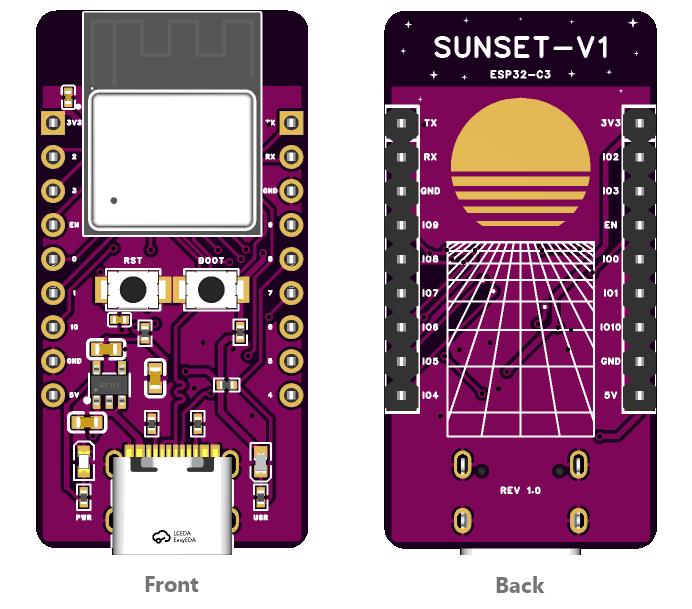
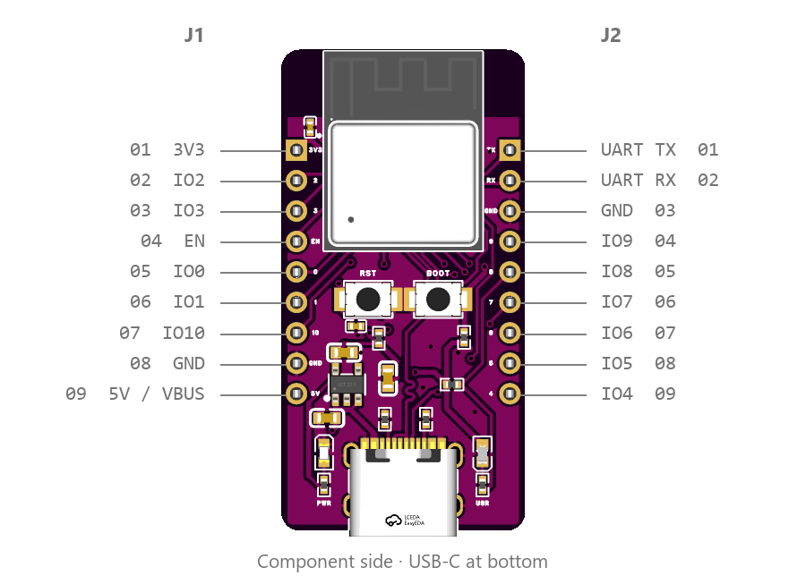

<h2 align="center">SUNSET-V1</h2>

<strong>SUNSET-C3 Mini Dev Board</strong> is a compact ESP32-C3 development board with USB-C.

  

  <a href="docs/pcb-front.png">Front</a> · <a href="docs/pcb-back.png">Back</a>

  <a href="hardware/SUNSET-C3-EasyEDA-Pro.zip">Download the EasyEDA Pro project</a> ·
  <a href="https://prodocs.easyeda.com/en/project/file-save-as-local/index.html">Import guide</a>

<h3 align="center">Specifications</h3>

<table align="center">
  <thead>
    <tr><th align="center">Feature</th><th align="center">Details</th></tr>
  </thead>
  <tbody>
    <tr><td align="center">Module</td><td align="center"><a href="https://documentation.espressif.com/esp32-c3-mini-1_datasheet_en.html">ESP32-C3-MINI-1-N4</a> · 160 MHz RISC-V · 4 MB flash</td></tr>
    <tr><td align="center">Wireless</td><td align="center">2.4 GHz Wi-Fi (802.11 b/g/n) · Bluetooth 5 LE</td></tr>
    <tr><td align="center">USB-C</td><td align="center">5 V VBUS · native USB Serial/JTAG</td></tr>
    <tr><td align="center">Power</td><td align="center">3.3 V rail via ME6211C33M5G-N</td></tr>
    <tr><td align="center">Headers</td><td align="center">Two 9-pin through-hole rows · 2.54 mm pitch</td></tr>
    <tr><td align="center">Controls</td><td align="center">Reset (EN) and Boot (GPIO9) · power and user LEDs</td></tr>
    <tr><td align="center">PCB</td><td align="center">20.32 × 40.13 mm · two copper layers · ~1.6 mm nominal thickness</td></tr>
  </tbody>
</table>

<h3 align="center">Header pinout</h3>

  

<h3 align="center">License</h3>

The SUNSET-V1 hardware design is licensed under <a href="LICENSE">CERN-OHL-P-2.0</a>.

