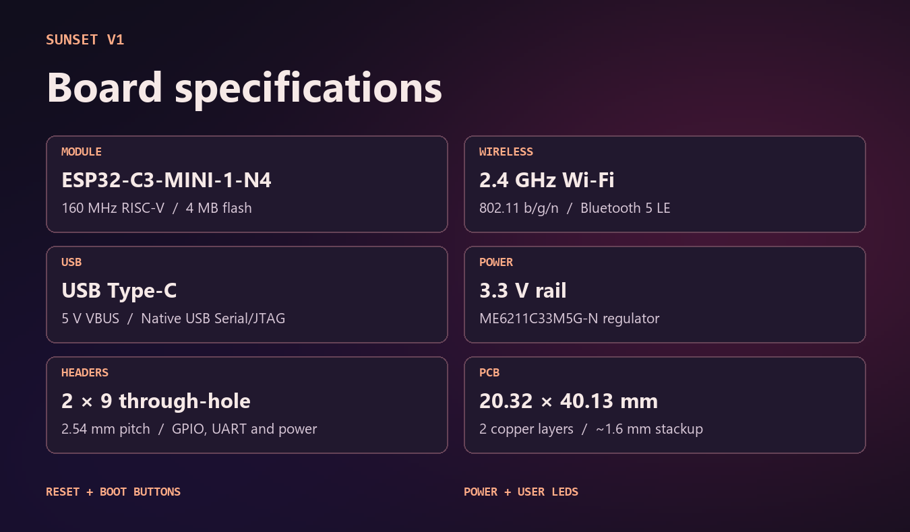
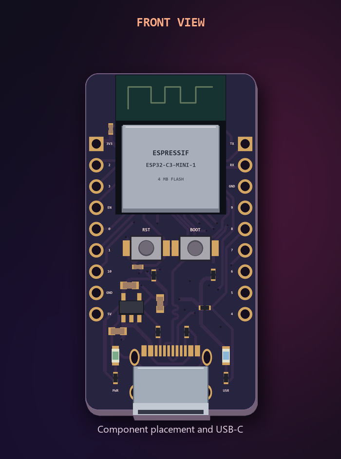
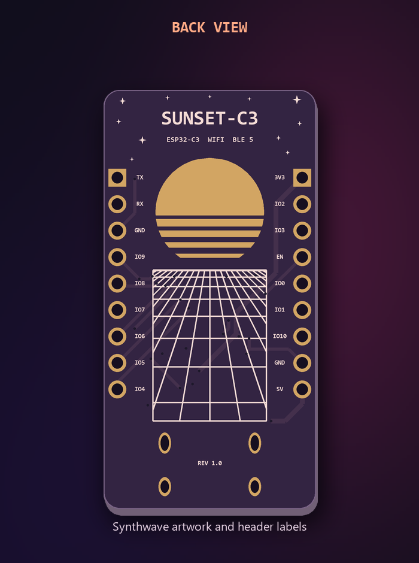

# SUNSET-V1

**SUNSET-C3 Mini Dev Board** is a compact ESP32-C3 development board with USB-C, two rows of through-hole headers, and synthwave artwork on the back.

## Specifications

| Feature | Design |
| --- | --- |
| Module | Espressif ESP32-C3-MINI-1-N4, single-core RISC-V up to 160 MHz, 4 MB flash |
| Wireless | 2.4 GHz Wi-Fi (802.11 b/g/n) and Bluetooth 5 LE |
| USB | USB Type-C with 5 V VBUS and native USB Serial/JTAG |
| Regulator | ME6211C33M5G-N, 3.3 V output |
| Headers | Two 9-pin through-hole rows at 2.54 mm pitch |
| Controls | Reset (EN) and Boot (GPIO9) pushbuttons |
| Indicators | Power and user LEDs |
| PCB | 20.32 × 40.13 mm, two copper layers, approximately 1.6 mm nominal stackup |

[Espressif module datasheet](https://documentation.espressif.com/esp32-c3-mini-1_datasheet_en.html)

## Header pinout

The graphic shows the board from the component side with USB-C at the bottom. J1 is on the left and J2 is on the right.

## PCB views

 

The illustrations use the PCB outline, footprint placement, header nets, and artwork from the saved design. Component bodies, colors, and finishes are illustrative.

## EasyEDA Pro project

[Download the native project backup](hardware/SUNSET-C3-EasyEDA-Pro.zip). The archive contains the schematic, PCB layout, and project libraries saved by EasyEDA Pro 3.2.209 on November 13, 2026. Use the project import option on the EasyEDA Pro start page to open a copy. [EasyEDA Pro project import and export guide](https://prodocs.easyeda.com/en/project/file-save-as-local/index.html)
